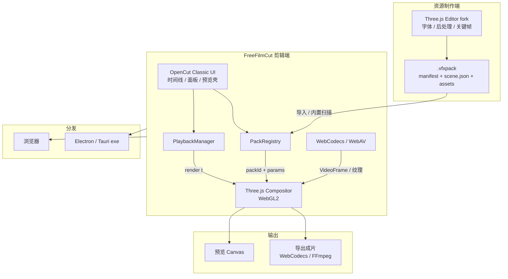
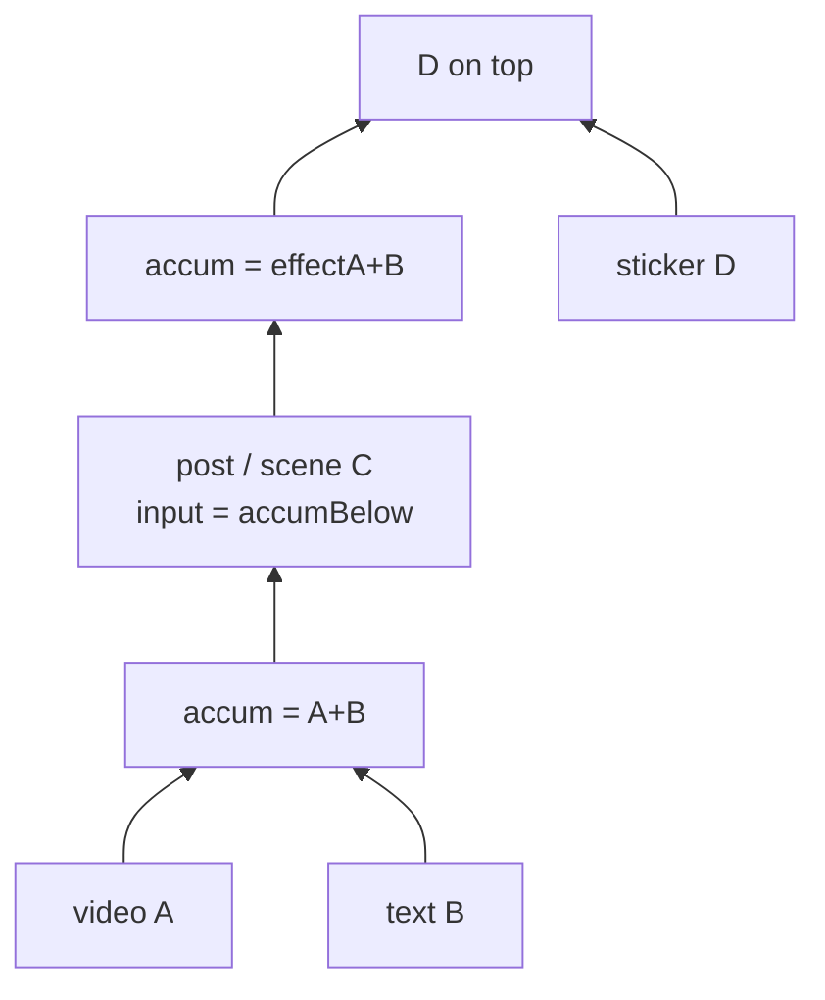

# FreeFilmCut 架构文档

> 定稿日：2026-10-13（Asia/Shanghai）  
> 项目名：**FreeFilmCut**  
> 一句话：**OpenCut Classic 做剪辑 UI/时间线，Three.js（WebGL2）做合成渲染；改 Three.js Editor 做资源包，导出 `.vfxpack`；支持浏览器与 Electron/Tauri 打成 exe。**

---

## 1. 目标与边界

### 1.1 要做什么

- 剪映式多轨 NLE：导入素材、时间线编辑、特效/转场/艺术字/动画/后处理/场景包、预览与导出。
- **Web 可跑**，同一套代码可 **本地打包成 Windows `.exe` 安装包**。
- 自研资源生态：特效包可在「资源编辑器」里制作并导入剪辑端，**所见即所得**（编辑器与 NLE 共用同一套 Three.js 合成内核）。

### 1.2 不做 / 明确放弃

- 不 1:1 复刻剪映私有格式（如 `.magics`），只对齐产品概念。
- **不跑 Unity / Godot Runtime**；主路径为 Three.js。Godot 仅作可选学习工具（本机已有 `D:\GrokbotWork\Godot\4.7.2\`）。
- 不以 OpenCut 主仓重写版为 UI 底座（仍在从零重写，不稳定）。

---

## 2. 技术选型总览

| 层 | 选型 | 说明 |
|----|------|------|
| 产品名 | **FreeFilmCut** | 仓库/目录：`D:\GrokbotWork\FreeFilmCut` |
| NLE UI / 时间线 | [OpenCut Classic](https://github.com/OpenCut-app/opencut-classic)（MIT） | Next.js + React + TS + Tailwind + Zustand；保留壳，换渲染 |
| 不推荐作底座 | [OpenCut 主仓](https://github.com/OpenCut-app/OpenCut) | 重写中，见 [issue #811](https://github.com/OpenCut-app/OpenCut/issues/811) |
| 渲染引擎 | **Three.js（WebGL2）** | FBO 多 Pass、VideoTexture、Mesh、后处理链；艺术字可配 MSDF/SDF（如 troika-three-text） |
| 资源编辑器 | **fork [Three.js Editor](https://github.com/mrdoob/three.js/tree/dev/editor)**（MIT） | 补字体 SDF/MSDF、后处理、动画关键帧；导出 `.vfxpack` |
| 资源包格式 | 自研开放约定 **`vfxpack/1` → `1.1`（含 scene）** | zip：`manifest` + `scene.json` + shaders/textures/meshes/fonts/curves |
| 媒体解码 | **WebCodecs**（可选叠 [WebAV](https://github.com/WebAV-Tech/WebAV)） | 预览与导出同一合成管线出帧 |
| 桌面分发 | **Electron 或 Tauri** | 浏览器直接跑；exe 更好用本地文件与硬件解码 |
| 协议偏好 | MIT / Apache-2.0 优先 | OpenCut Classic、Three.js 均为 MIT |

---

## 3. 系统架构（总图）



---

## 4. 剪辑端（NLE）

### 4.1 从 OpenCut Classic 保留什么

保留界面与编辑语义，**替换 GPU 预览/特效实现**：

- `components/`、`core/`（EditorCore）、`timeline/`、`panels/`、`editor/`
- `media/`（素材入库、OPFS）、`project/`、`commands/` + 撤销重做
- `preview/` 面板壳与交互（缩放、吸附、hit-test）——中心改为挂 Three.js `<canvas>`

关键接线（保留接口、换实现）：

| 接点 | 处置 |
|------|------|
| `EditorCore` | 时间线状态真源，保留 |
| `RendererManager` | 外壳保留，内部改调 Three.js Compositor |
| `PlaybackManager` + RAF | 每帧 `engine.setTime(playhead); engine.render()` |
| `initializeGpuRenderer()` | 换成 Three.js WebGL2 初始化 |
| 旧 HTML/Canvas 合成、Rust/WASM compositor、旧 effects GPU | **整段替换** |

参考：[Classic 仓库](https://github.com/OpenCut-app/opencut-classic)、[架构说明](https://opencut-app-opencut.mintlify.app/development/architecture)。

### 4.2 Three.js 合成管线（对应原「七模块」）

| 模块 | 职责 |
|------|------|
| ① Scene / Timeline 模型 | tracks → clips → transforms / effects / transitions / text；可继续用 OpenCut 数据 |
| ② Media Decode & Upload | WebCodecs + `<video>` 回退；帧上传为纹理 |
| ③ Texture / RT 池 | 视频帧、LUT、贴纸、SDF atlas、中间 RenderTarget |
| ④ Geometry / Mesh | 全屏三角、裁剪矩形、变形网格、转场网格 |
| ⑤ Shader Effects | 多 Pass；clip-local 特效 |
| ⑥ Transition | A/B + `progress∈[0,1]` |
| ⑦ SDF/MSDF Text + Keyframe | 艺术字；transform/opacity/param 关键帧 |
| ⑧ **栈序 Compositor** | 含后处理中断（见 §6） |

预览与导出：**同一条合成链** → 预览 present 到 Canvas；导出逐帧离屏再送 Encoder。

### 4.3 建议 monorepo 布局（示意）

```
FreeFilmCut/
  apps/
    web/                 # OpenCut Classic 改造后的 NLE
    asset-editor/        # Three.js Editor fork
    desktop/             # Electron 或 Tauri 壳
  packages/
    render-engine/       # Three.js Compositor + PackLoader
    vfxpack/             # schema、PackRegistry、校验
    builtin-packs/       # 内置 dissolve / blur / art-text / post-blur
  docs/
    architecture.md      # 本文
  README.md
```

---

## 5. 资源包 `.vfxpack`

### 5.1 目录结构（zip，扩展名 `.vfxpack`）

```
my-effect.vfxpack
└── pack/
    ├── manifest.json
    ├── scene.json              # 场景类包必填（vfxpack/1.1）
    ├── scenes/                 # 可选多场景
    ├── shaders/                # GLSL ES 3.00 / Three RawShaderMaterial 用
    ├── meshes/                 # glTF 或 json
    ├── textures/
    ├── fonts/                  # ttf/otf 或预烘焙 SDF atlas
    ├── curves/                 # 关键帧预设
    ├── materials/              # 可选
    ├── preview/
    │   ├── thumb.webp
    │   └── demo.mp4            # 可选
    └── i18n/
        └── zh-CN.json
```

约定：路径相对 `manifest.json`；禁止绝对路径 / 外链脚本；未知字段忽略以保证前向兼容。

### 5.2 资源类型

| `type` | 挂载方式 | 渲染 |
|--------|----------|------|
| `effect` | **挂到 clip**（`packId + params`） | clip-local 多 Pass |
| `filter` | **拖到轨道**（吃下层画面） | `scope: below` 滤镜 |
| `transition` | 两 clip 间隙 / 转场段 | A/B + progress |
| `text-style` / `art-text` | 文字 clip 样式 | SDF/MSDF |
| `animation` | clip.animations[] | 关键帧曲线 |
| `sticker` | 可挂 clip 或拖到轨 | 贴图 + 可选 shader |
| **`post-effect`** | **拖到轨道线** | `scope: below`，下层 accum 为输入 |
| **`scene`** / overlay | **拖到轨道线** | 场景离屏渲；可采下层画面为输入纹理 |

资源编辑器在 **Project → VFX PACK** 选择包类型（`sticker` / `transition` / `effect` / `filter` / `art-text`），导出时写入 `manifest.type`；导出对话框只询问包名。

### 5.3 `manifest.json` 要点

- `schema`: `"vfxpack/1"` 或 `"vfxpack/1.1"`（含 scene）
- `id` / `version` / `displayName` / `engine.api: "webgl2"`
- `type`、`scope`（`clip` | `below` | `stack`）、`passes`、`params[]`
- 场景包：`entry.scene`、`params[].path` 指向场景节点参数

### 5.4 `scene.json`（场景 / 叠加层）

开放 JSON 场景图（**不是** `.unity` / Prefab）：

- 节点可含：相机、灯光、Mesh、UI 画布与文字、特效、后处理挂点
- 素材经 `assets` / 相对路径引用 `meshes/`、`textures/`、`fonts/`、`shaders/`
- NLE 用 SceneLoader 识别并渲；**不解释 Unity 原生格式**

滤镜 / 后处理 / 部分场景：节点可声明输入语义为下层合成图（`accumBelow` / pipeline `source`），见 §6。

---

## 6. 合成规则：下层输入、上层不受影响

产品规则（剪映式）：

> **后处理、叠加层、场景类资源：把比它层级低的已合成画面当作输入纹理；比它高的层叠在其输出之上，不受该效果影响。**

### 6.1 栈循环伪代码

```
stack = sorted_drawables(t)   // 底 → 顶
accum = clear(RT0)

for item in stack:
  if item.needsBelowInput:    // post-effect / overlay / scene(scope=below)
    src = accum
    dst = acquire_RT()
    render_item(item, input=src → dst)   // 多 Pass ping-pong
    release(src); accum = dst
  else:
    composite_item(item → accum)         // 普通 clip / 字 / 贴纸

present(accum)
```

### 6.2 作用域

| `scope` | 含义 |
|---------|------|
| `clip` | 只处理当前片段（默认 `effect`） |
| `below` | 剪映式后处理 / 轨上滤镜场景（默认 `post-effect`） |
| `stack` | 全局/帧末（字段预留） |

### 6.3 示例

```
D  sticker          ← 最高
C  blur-post (below)
B  text
A  video            ← 最低

final = D ∘ blur(A + B)     // D 清晰；A/B 被糊
```



**场景「离屏合成」**：场景先渲到离屏 RT（实时、每帧），再作为一层参与时间线；若声明需要下层输入，则先把下方 accum 绑成场景内纹理再渲。

---

## 6.4 Shader below-input contract (`uInput`)

Special `sampler2D` uniform names on ShaderMaterials inside a `.vfxpack`:

| Name | Role |
|------|------|
| **`uInput`** (preferred) | Below-track composite texture |
| `belowInput` | Alias |
| `iChannel0` | Alias (ShaderToy-style) |

**When bound:** pack `type` is `filter` or `effect`, and `scope` is `below` (default for those types in `load-pack.ts`).

**Pipeline:** `three-compositor.ts` keeps an offscreen accum RT. Before drawing such a pack it snapshots accum → `belowSourceRT`, walks the pack scene, assigns that texture to every matching uniform, clears accum, then renders the pack (output replaces content below; upper items still stack on top).

Authoring: declare the uniform in GLSL + Info JSON; see `docs/vfxpack-editor.md` § Below-track input. Implementation: `vfxpack/below-input.ts`, `scene-builder.ts` (`ensureBelowInputUniforms`), `compositor/three-compositor.ts`.

## 7. PackRegistry 与挂载 UX

```
导入 .vfxpack / 扫描 builtin-packs/
  → PackRegistry.install
  → 解压 OPFS/IndexedDB → 校验 schema → compile shader → 面板可见
```

两种挂法（必须都支持）：

1. **挂到 clip**：滤镜/片段特效等 → `clip.attachments += { packId, type, paramValues }`
2. **拖到轨道线**：后处理、叠加层、场景类 → 自成一层，带 `zOrder`，参与栈序合成

面板按 `type` + `scope` 分流：clip 面板 vs 特效/后处理轨。参数 UI 由 `params[]` 动态生成；改值只写时间线实例，不改包文件。

---

## 8. 资源编辑器（Three.js Editor fork）

| 能力 | 说明 |
|------|------|
| 基于 | [three.js/editor](https://github.com/mrdoob/three.js/tree/dev/editor)，在线参考 [threejs.org/editor](https://threejs.org/editor/) |
| 增强 | SDF/MSDF 字体、后处理节点、`scope: below` 预览、动画关键帧时间轴 |
| 导出 | 一键打成 `.vfxpack`（manifest + scene.json + 资源） |
| 预览内核 | **与 NLE 同一 `packages/render-engine`**，避免两套效果不一致 |

可选辅助（非主路径）：[NodeToy](https://nodetoy.co/) 做 shader 节点、[Theatre.js](https://www.theatrejs.com/) 做动画曲线、[ShaderToy](https://www.shadertoy.com/) 试片元滤镜。

---

## 9. Web 与 exe 双端

| 形态 | 方式 |
|------|------|
| Web | `apps/web` 部署静态/SSR；浏览器内 WebGL2 + WebCodecs |
| Windows exe | Electron 或 Tauri 包同一前端；可加强本地文件访问、硬件解码 |

原则：**一套渲染与资源契约，两套壳**；业务逻辑不进桌面壳。

---

## 10. 分阶段路线图（MVP → 完整）

| 阶段 | 目标 | 验收 |
|------|------|------|
| **P0 契约** | 定 `vfxpack/1`；手写三包：`dissolve`、`blur`、`art-basic`；可选 `post.blur` | schema + 样例 zip 可人工打开校验 |
| **P1 引擎 demo** | `packages/render-engine`：Three.js blit + PackLoader + `below` 栈合成（可独立 canvas 页） | scrub 可见 dissolve/blur；A+B+post+D 贴纸语义正确 |
| **P2 编辑器** | fork Three Editor：导入/导出 `.vfxpack`；字体与后处理最小 UI | 编辑器导出 blur → demo 页导入一致 |
| **P3 NLE 接线** | clone OpenCut Classic；预览换 Three canvas；特效面板接 PackRegistry；clip 挂载 + 轨上拖放 | 导入素材 → 拖特效/后处理 → 预览正确 |
| **P4 场景包** | `scene.json` + SceneLoader；下层画面作场景输入 | 相机/Mesh/UI + 滤镜场景可进时间线 |
| **P5 导出与桌面** | 同管线离屏导出；Electron/Tauri 打 exe | Web 与 exe 同一工程可导出成片 |

**刻意延后：** 粒子完整模拟、超复杂 Unity 级材质全集、WebGPU 后端、云草稿/模板商城。

---

## 11. 风险与注意

- Three.js Editor 官方能力偏基础，字体/后处理/关键帧需自研增强，工作量集中在编辑器与契约，而非「再写一个游戏引擎」。
- Shader 需锁定 GLSL ES 3.00 / Three 材质约定，避免编辑器与 NLE 编译不一致。
- OpenCut Classic 与主仓 API 会漂，**只依赖 classic 可跑分支**，渲染边界收在 `RendererManager` / `render-engine`。
- 中文艺术字：选用带 CJK 的字体，并走 MSDF/SDF，避免运行时缺字。

---

## 12. 参考链接（已核实）

- OpenCut Classic：https://github.com/OpenCut-app/opencut-classic  
- OpenCut 主仓：https://github.com/OpenCut-app/OpenCut  
- OpenCut 架构文档：https://opencut-app-opencut.mintlify.app/development/architecture  
- Three.js：https://github.com/mrdoob/three.js  
- Three.js Editor 源码：https://github.com/mrdoob/three.js/tree/dev/editor  
- Three.js Editor 在线：https://threejs.org/editor/  
- WebAV：https://github.com/WebAV-Tech/WebAV  

---

## 13. 与历史简报的关系

本文件合并并 supersede 商店笔记中的方向（`opencut-render-architecture-brief`、`asset-pack-architecture`、`post-process-layer-compositing`、`vfxpack-scene-file`），并按最终定案更新为：

- 渲染底座：**Three.js**，不再以「纯自研裸 WebGL2」或 Unity/Godot Runtime 为主路径  
- 资源作者工具：**Three.js Editor fork**，不再依赖 Unity 导出器（旧 `unity-vfxpack-export` 仅作历史参考）  
- 产品名与目录：**FreeFilmCut** @ `D:\GrokbotWork\FreeFilmCut`

## VfxPack render settings

`.vfxpack` ≥ 1.2 carries Scene background / environment / fog and Project tone mapping; the NLE Three compositor applies them per pack. Custom ShaderMaterial GLSL is fully embedded under `shaders/`.
